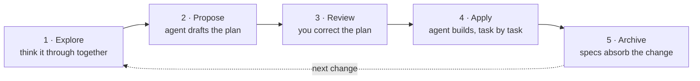

# Spec-kit 规范驱动开发

## install and setup

- `npm install -g @fission-ai/openspec@latest`
- cd <your-project>
- `openspec init`
  - An 'openspec/' folder at the repo root
  - Workflow files: skills in the shared '.agents/skills/' folder, with links from a tool's own folder where it needs them ('.claude/skills/', for example)


```
openspec/
├── config.yaml     project settings and context for the AI
├── specs/          your specs (empty for now)
└── changes/        in-motion changes (empty for now)
    └── archive/    completed changes move here

.agents/skills/
├── openspec-explore/              think through an idea first
├── openspec-propose/              propose a change
├── openspec-apply-change/         implement a change's tasks
├── openspec-update-change/        revise a change's plan
├── openspec-sync-specs/           sync a change's spec updates into specs/
├── openspec-archive-change/       move a finished change to the archive
├── openspec-verify-change/        check the implementation matches the plan (not included by default)
└── openspec-bulk-archive-change/  archive several changes at once (not included by default)
```

## Start from an empty project

```
/openspec explore 我要建立Python爬蟲程式，爬取PTT棒球版的文章標題，範例網址如下 https://www.ptt.cc/bbs/baseball/index.html
/openspec apply ...
/openspec archive ...
```



|Workflow	|What it's for|
|---|---|
|explore|	Think through an idea before it becomes a change proposal|
|propose|	Create a change proposal and generate all its planning artifacts in one step|
|appl|y	Implement a change proposal's tasks|
|update|	Revise a change proposal's existing planning artifacts|
|sync|	Merge a change proposal's spec updates into specs/ without archiving it|
|archive|	Move a finished change proposal to the archive|

## customization options

|Option|	What it changes|	Use it when|
|---|---|---|
|Profiles	|Which workflows are installed|	You want additional workflows and working patterns, or to remove workflows you don't need|
|Project configuration|	The instructions injected into every workflow run: context, rules, and operation guidance (`config.yaml`)	|You want changes planned your way, like tasks always including Playwright tests|
|Schemas|	What OpenSpec produces: the artifacts, their order, and their templates|	Changes should produce different planning files, sections, or formats|

**optional workflows**

|Workflow	|What it's for|
|---|---|
|new|	Start a change proposal as an empty scaffold|
|continue|	Create the next planning artifact in a change proposal, one at a time|
|ff|	Create a change proposal and every planning artifact implementation needs, in one pass|
|verify|	Check that the implementation matches the change proposal's artifacts|
|bulk-archive|	Archive several change proposals at once|
|onboard|Learn the workflow by doing one real change proposal end to end|

> References
- [Open spec framework](https://openspec.dev/)
- [github Spec-Kit](https://github.com/github/spec-kit)
- [Spec-Kit 中文汉化版](https://github.com/888888888881/spec-kit-chinese)
- Sample
  - [novel-writer](https://github.com/wordflowlab/novel-writer)
  - [公众号/自媒体文章创作](https://github.com/wordflowlab/article-writer)
