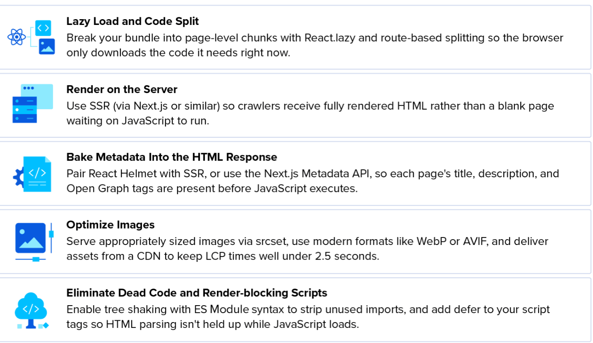

[React学习-SEO Optimization](#top)

- [Sitemap and Crawl Budget](#sitemap-and-crawl-budget)
- [Best Rendering strategies](#best-rendering-strategies)
- [Metadata and Dynamic Tag Management](#metadata-and-dynamic-tag-management)
- [Optimizing React Apps for SEO](#optimizing-react-apps-for-seo)
  - [Lazy Loading for React Performance](#lazy-loading-for-react-performance)
  - [Page Speed Optimization](#page-speed-optimization)
- [Image Optimization](#image-optimization)
- [Actionable Optimization Checklist](#actionable-optimization-checklist)


----------------------



## Sitemap and Crawl Budget

-  well-structured sitemap helps Google focus its crawl budget on the most important pages. But React won’t build one
- If using React Router, you’ll need additional tooling to generate a sitemap from your URL paths. You can use **robots.txt** to steer crawlers away from pages that don’t need indexing (admin pages, login screens, duplicate filtered views, etc.) and monitor crawl budget in Google Search Console.

## Best Rendering strategies

- **Server-Side Rendering (SSR)**: The server generates the complete HTML for every request so search engines and users get immediate content. Frameworks like Next.js handle this out of the box.
- **Static Site Generation (SSG)**: Pages are pre-built to static HTML files at build/deploy time, ideal for content that doesn't change on every request.
- **Pre-rendering Layers**: If you have an existing client-side React SPA that you cannot easily rewrite, place a pre-rendering service or build-time snapshot layer in front of the app to serve crawlers finished HTML

## Metadata and Dynamic Tag Management

- **Native Metadata (React 19)**: React 19 provides built-in support for rendering <title> and <meta> tags directly from components.
- **Async Helmet Libraries**: For older React versions, use react-helmet-async to dynamically manage page titles, descriptions, canonical links, and Open Graph/Twitter tags. Keep in mind that helmet libraries still depend on JavaScript execution unless paired with SSR or pre-rendering.
  - In a purely client-side app, though, React Helmet still only updates the <head> after JavaScript executes in the browser, so on its own, it doesn’t solve the crawler visibility problem
  - Paired with server-side rendering, React Helmet can extract metadata from your component tree during the server render and inject it into the HTML response before it reaches the client
- **Next.js Metadata APIs** allow you to export a metadata object or a generateMetadata function directly
  -  Next.js handles server rendering, this metadata is included in the HTML response by default, making it visible to crawlers. It also supports dynamic metadata generation, so a product page can pull its title and description from a database at time of request and have them baked into the response
- **Structured Data**: Implement JSON-LD schema markup to help search engines

```html
<Helmet>
    <!-- Basic Meta Tags -->
    <title>Hair making booking application</title>
    <meta name="description" content="With this application, you can make reservations for your hair making services.">
    <!-- Open Graph Tags -->
    <meta property="og:title" content="Hair Making Booking Platform">
    <meta property="og:description" content="With this application, you can make reservations for your hair making services.">
    <meta property="og:image" content="https://encrypted-tbn0.gstatic.com/images?q=tbn:ANd9GcRxm-KxPDPU">
    <meta property="og:url" content="https://mywebsite.com">
    <meta property="og:type" content="website">
    <!-- Twitter Card Tags -->
    <meta name="twitter:card" content="summary_large_image">
    <meta name="twitter:title" content="Hair Making Booking Platform">
    <meta name="twitter:description" content="With this application, you can make reservations for your hair making services.">
    <meta name="twitter:image" content="https://encrypted-tbn0.gstatic.com/images?q=tbn:ANd9GcRxm-KxPDPU">
</Helmet>
```

[⬆ back to top](#top)

## Optimizing React Apps for SEO

### Lazy Loading for React Performance

- **React.lazy** lets you define components that are only loaded when they’re rendered. Instead of importing a component at the top of your file, you wrap it in `React.lazy()` and the browser fetches it on demand.
- **Suspense** works alongside React.lazy to show a fallback such as a loading indicator or skeleton screen while the “lazy” component is being fetched. This ensures the user sees something aside from a blank screen while the full bundle loads.
- **Route-based code splitting** separates your application’s JavaScript by page. If, say, a user lands on an app’s product page, the browser only downloads the code for that page, not the code for account settings or checkout. These bundles are only fetched later, if and when the user navigates to them.
- **Dynamic imports** (`import()`) let you defer heavier features or third-party libraries until a user needs them. They sit underneath tools like `React.lazy`, but can also be used to conditionally load larger modules. For example, a store locator might only load its map when someone opens the contact page.

### Page Speed Optimization

Optimizing React apps for speed typically involves three things: reducing how much JavaScript the browser has to load, removing redundant code from what remains, and ensuring scripts don’t block the browser from rendering the page
- **Code splitting** covered in the previous section, breaks your app into smaller bundles so the browser only has to download and execute the JavaScript needed to render the current page.
- **Tree shaking** targets dead code during the build process. If you’re importing a utility library but only using two of its functions, a properly configured bundler (e.g., webpack, Vite, esbuild) will exclude what you don’t need. This only works reliably with ES Module syntax (`import/export`). If your dependencies use CommonJS, you may be shipping unused code without realizing it.
- **Render-blocking scripts** hurt page speed. Any script in the `<head>` without `async` or `defer` prevents the browser from parsing the rest of the HTML until that script finishes loading. Adding `defer` to your main bundle’s script tag allows the browser to continue parsing HTML while JavaScript downloads in parallel, then execute the script once the document has been parsed.
- **Inlining critical CSS** addresses a related problem: It gives the browser the styles it needs to render above-the-fold content right away, without having to wait for a separate stylesheet request.

[⬆ back to top](#top)

## Image Optimization

- **Responsive images** ensure the browser downloads an appropriately sized file rather than forcing a 2400 px-wide image into a 400 px container. The `srcset` attribute on `` elements lets you specify multiple resolutions, and the browser selects the best match based on viewport size and device pixel ratio. This means a mobile user on a narrow screen isn’t downloading the same file as someone on a 27-inch monitor.
- **WebP and AVIF formats** offer significantly better compression than JPEG or PNG at comparable visual quality. WebP has broad browser support at this point; AVIF provides even better compression ratios where supported. The `<picture>` element lets you serve AVIF to browsers that support it and fall back to WebP or JPEG for those that don’t.
- **CDN delivery** serves images from edge locations closer to the user, reducing latency. Most CDN providers also offer on-the-fly transformation, including resizing, format conversion, and quality adjustment, so you don’t have to manually account for every image size and format in your build

## Actionable Optimization Checklist

- **Deliver Real HTML**: Use a framework (like Next.js or Vite-based SSG) or pre-render routes.
- **Unique Metadata**: Ensure every route has a unique, descriptive `<title>` and meta description.
- **Semantic Links**: Use standard HTML `<a>` tags with href attributes for internal navigation instead of JavaScript-only click handlers so crawlers can discover your pages.
- **Performance & Speed**: Code-split your bundles, lazy-load images, and optimize Core Web Vitals (LCLS/CLS).
- **Validate Crawling**: Test your live URLs using Google Search Console and inspect how Googlebot renders your pages

[⬆ back to top](#top)

- [React Js Tutorial - 28 - SEO Optimization in React](https://www.youtube.com/watch?v=4Qdea-FPppc)
